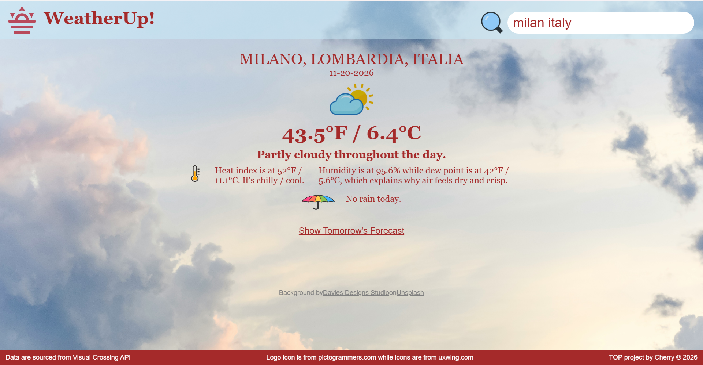
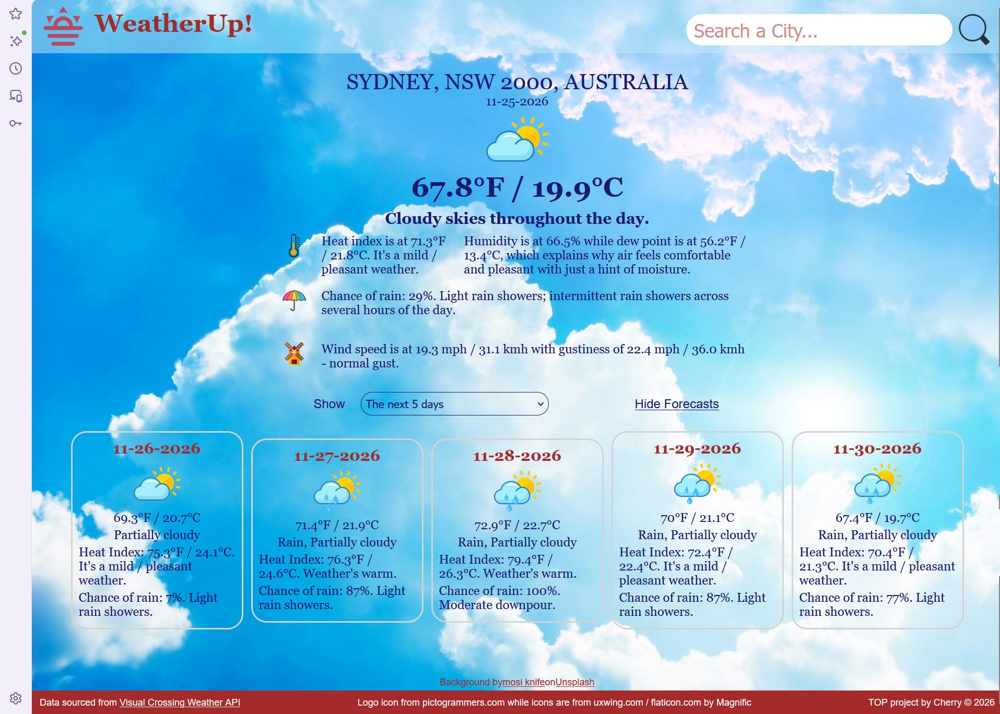
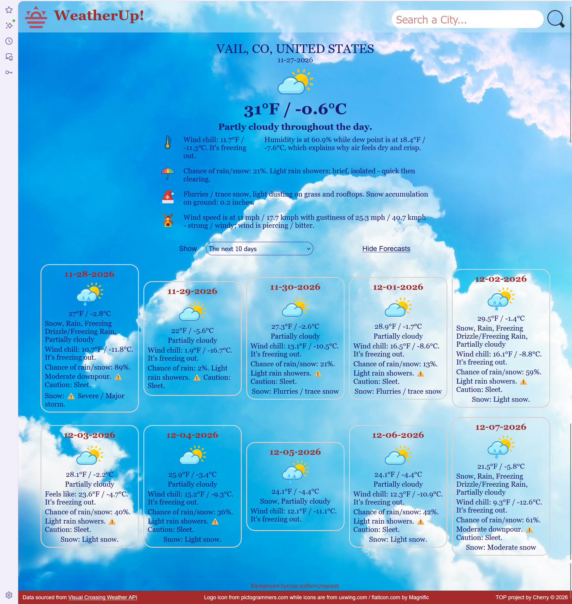
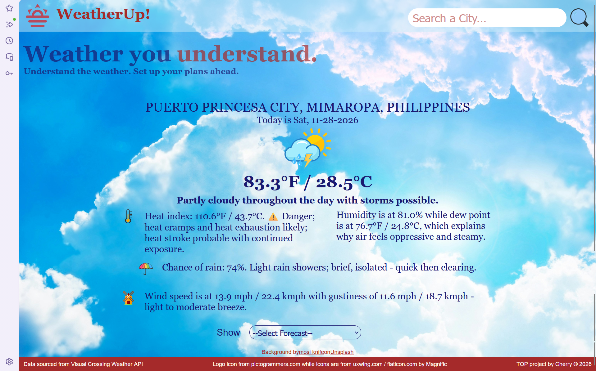

### Description

Project: Weather App from <a href="https://www.theodinproject.com/">The Odin Project</a> Full Stack JavaScript course.

Using HTML, CSS (Flexbox for layout) and JavaScript webpack.

Features:

1. Weather data for all cities around the world. User can search for any city (case-insensitive typing). For a more accurate result, user may type both city and country.
2. API data are sourced from <a href="https://www.visualcrossing.com/weather-api/">Visual Crossing API</a>.
3. Parameters fetched include forecasts for 7 days for elements not limited to temperature, summary and description of conditions, feels like temperatures, humidity, dew point temperature, rain probability, rainfall measurement, rain cover, wind conditions.
4. I only choose to show ONLY the next 5 days forecast. User can have the option to view these or NOT.
5. I'd have stopped to show ONLY numbers, but I wanted to add some laymen descriptions. For example, for the heat index, while the numbers are sourced from the API, the category range descriptions are loosely sourced from PAGASA (through google).
6. Same for rain descriptions. I use the precipitation numbers from the API and searched through google for loose category range descriptions. All these of course can be read in the code.

Screenshots:

